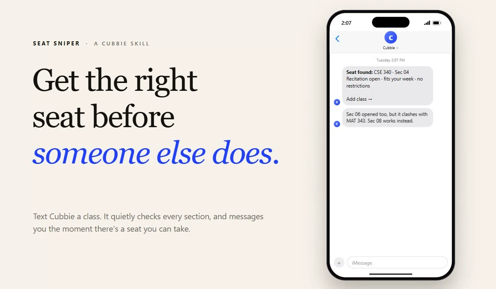
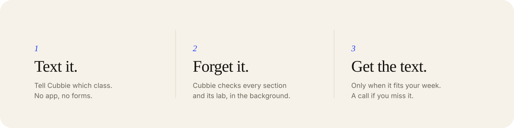
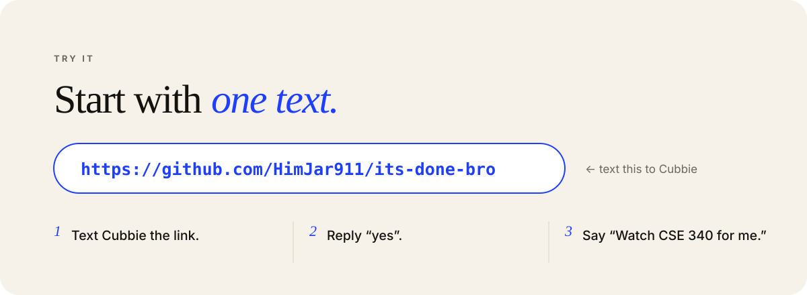
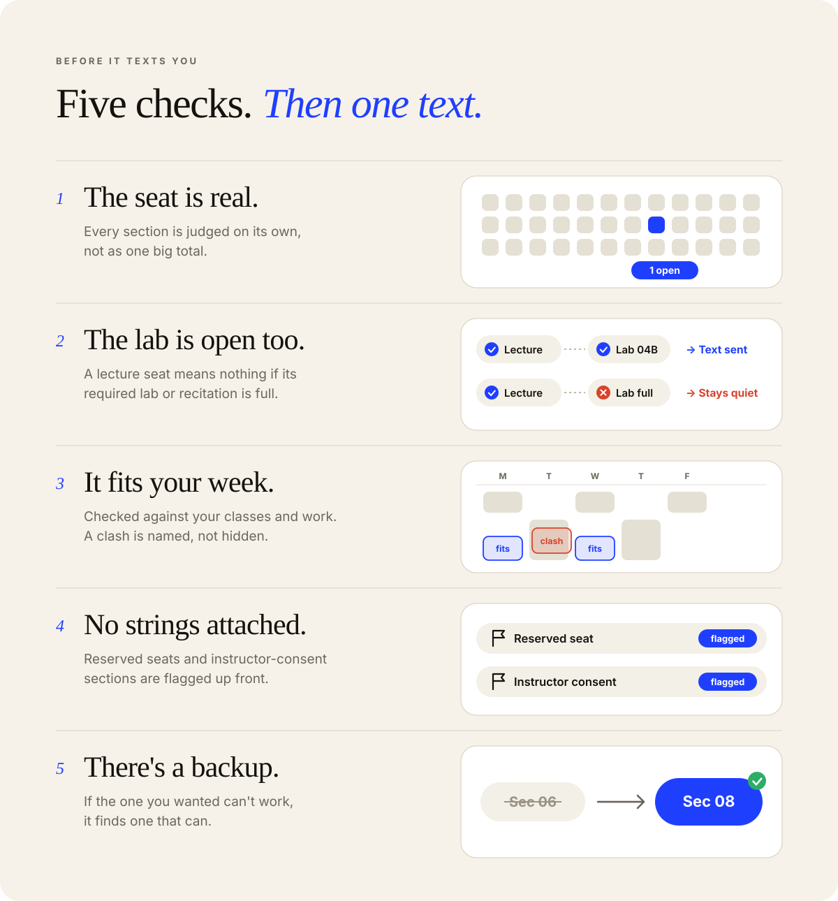
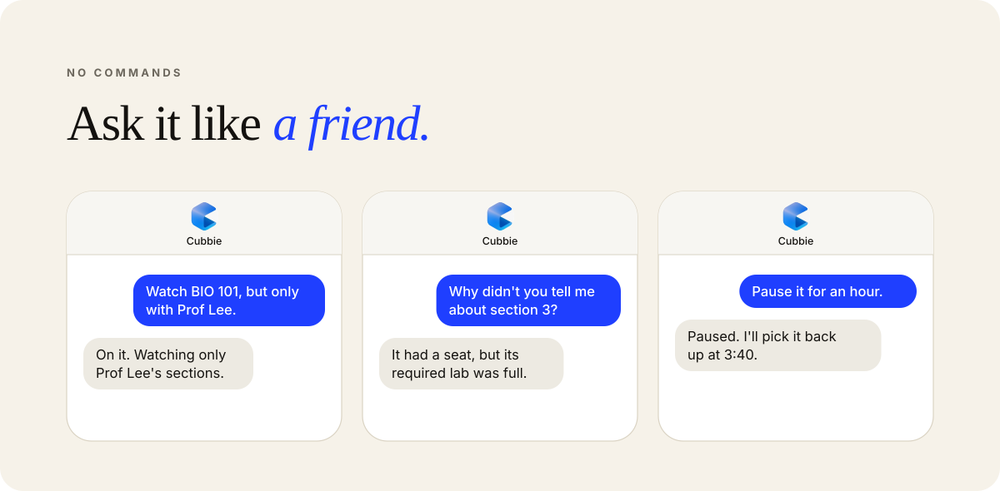
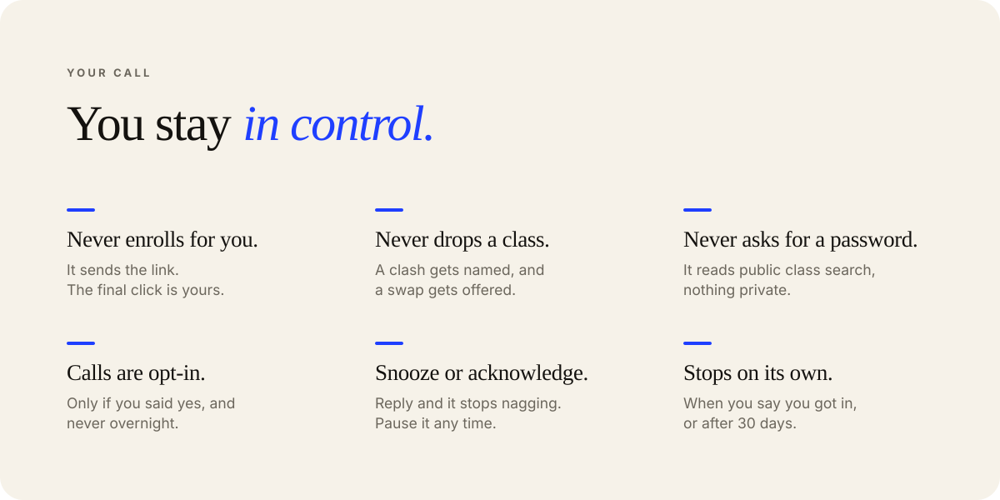
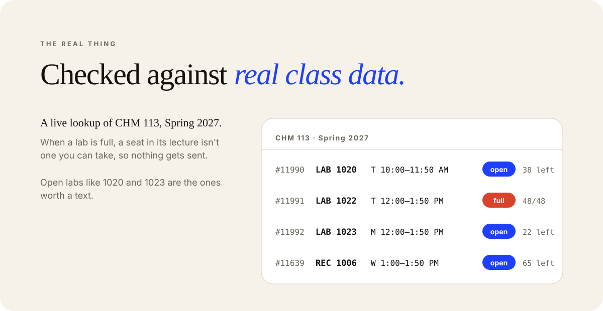
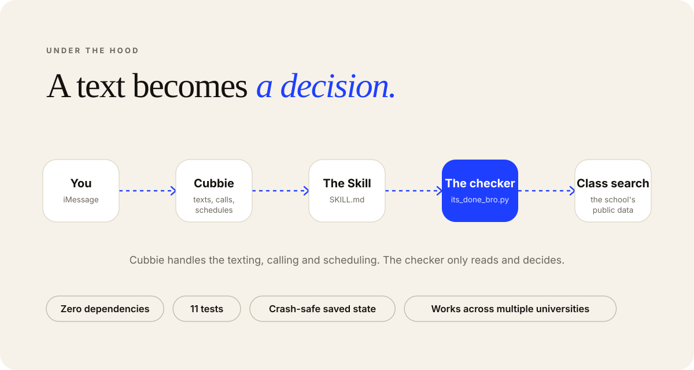

 

<b>How an alert is decided</b>

 

Every section of the course is checked on its own, never as one combined total. A section counts as one you can take only when all of this is true:

- the section itself has a seat open
- every lab or recitation it requires also has a seat open
- it doesn't overlap the classes and commitments you've shared
- reserved seats and instructor-consent sections are flagged, not hidden

If something opens but you can't take it, nothing is sent. If another section of the same course works, you hear about that one instead. If a seat you were told about closes again, you're told once.

After a text, if you've said yes to calls and haven't replied within a few minutes, Cubbie calls. Quiet hours (10 PM to 7:30 AM) block calls.

<b>Which schools it works with</b>

 

It reads a school's public class search, so there's no sign-in and nothing private. It's been tested on live class data from several universities. For a school it can't read directly, Cubbie can copy the sections off the class-search page into a list the checker understands. See `references/schools.md`.

<b>Questions</b>

 

**Does it register me for the class?** No. It sends you the registration link and you finish it yourself.

**Do I give it my password?** No. It never asks for one.

**What if I miss the text?** If you opted in, Cubbie calls. You can also say "pause it for an hour" or "stop watching it" at any time.

**Can I watch more than one class?** Yes, up to ten at once.

**How do I stop it?** Tell Cubbie you got in, or just say stop. It also ends a watch on its own after 30 days.

<b>What's in this repo</b>

 

| Path | What it is |
| --- | --- |
| `SKILL.md` | How Cubbie understands, schedules and replies |
| `scripts/its_done_bro.py` | The checker. Standard library only, no installs |
| `references/schools.md` | Setting up a school |
| `tests/` | 11 tests covering the alert logic |

 

[**Like It's Done Bro? Vote for it →**](https://hackathon.cubbie.ai/#gallery)

