<div align="center">












<a href="https://hackathon.cubbie.ai/#gallery"></a>

</div>

**Install:** text this link to Cubbie, reply `yes`, then say `Watch CSE 340 for me.`

```
https://github.com/HimJar911/seat-sniper
```
