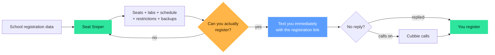

<div align="center">

# Seat Sniper 🎯

### Get the right seat before someone else does.

**Seat Sniper watches your classes in the background, finds openings you can actually register for, and alerts you immediately with everything you need to grab the seat.**

Labs. Recitations. Schedule conflicts. Restrictions. Backup sections. Checked before we bother you.

  

<br/>



<sub>Example scenario.</sub>

</div>

## Basic seat trackers vs Seat Sniper

**Basic tracker:** "A seat opened."  
**Seat Sniper:** "A seat opened. You can actually take it. Your recitation works. It fits your schedule. Here's the registration link. Go."

| Capability | A plain seat alert | Seat Sniper |
| --- | :---: | :---: |
| Detects an open seat | ✓ | ✓ |
| Watches every matching section of a course | — | ✓ |
| Checks the required lab or recitation | — | ✓ |
| Checks your existing schedule | — | ✓ |
| Catches registration conflicts before you do | — | ✓ |
| Finds a backup section when the first one fails | — | ✓ |
| Warns about reserved or instructor-consent seats | — | ✓ |
| Texts you the moment it's usable | ✓ | ✓ |
| Direct registration link in the alert | varies | ✓ |
| Calls if you miss the text (opt-in) | — | ✓ |
| Snooze and acknowledge | — | ✓ |
| Never drops a class for you | — | ✓ |
| Cross-school support | varies | ✓ |

## Quick start

1. Text Cubbie this link and reply **yes**:

   ```text
   https://github.com/HimJar911/seat-sniper
   ```

2. Say: **"Watch CSE 340 for me."**

That's it.

## Seats don't stay open for long

You shouldn't have to keep refreshing a registration page hoping to be there at exactly the right moment.

Seat Sniper watches in the background. When an opening appears, it checks whether you can actually take it and puts the registration link in front of you immediately. The goal is to shrink one gap as far as possible:

**seat opens → you know → you register**

That's why the direct registration link is part of the alert, and why a missed text can turn into a phone call.

## Smarter than a seat counter

A seat becoming available doesn't mean you can register for the class. Seat Sniper checks the whole situation first:

| Check | What Seat Sniper asks |
| --- | --- |
| **Linked components** | Is the required lab or recitation open too? |
| **Your schedule** | Does the section fit around your existing classes? |
| **Restrictions** | Is the seat reserved, or does it need instructor consent? |
| **Alternatives** | If this section doesn't work, is another one open that does? |
| **Speed** | If it works, the alert and the registration link reach you right away. |
| **Escalation** | Miss the text? Cubbie can call, if you've said yes. |

**Seat Sniper doesn't just watch seat counts. It watches for registration opportunities you can actually use.**

And it never drops a class for you. If a section clashes with something you're already in, it names the conflict and offers the alternative:

> *"Section 06 opened, but it overlaps MAT 343."*
> *"Section 08 is open and fits your schedule instead."*

## How it works



## Everything it does

| Feature | What it does |
| --- | --- |
| **Whole-course watching** | "Watch CSE 340" covers every matching section. Add a professor, campus or online-only if you care. |
| **Linked labs and recitations** | A lecture seat only counts if the lab or recitation you need is open too. |
| **Schedule conflicts** | Checked against your calendar before you're alerted. |
| **Backup sections** | If the one you wanted can't work, it finds one that does. |
| **Restriction warnings** | Reserved seats and instructor-consent sections are flagged. |
| **Text, then optional call** | Say yes once and it calls if you miss the text. Quiet hours keep it from ringing at 2 am. |
| **Snooze and acknowledge** | Pause a watch, or tell it you've seen the alert. |
| **Tells you what it skipped** | Ask "why didn't you tell me about section 3?" and it explains. |
| **Stays honest** | It tells you if it can't see the school's class data, says when a seat fills again, and stops watching on its own when registration ends. |
| **Cross-school support** | Works across multiple universities. |

## Example conversation

```text
You:    Watch CSE 340 for me.
Cubbie: Got it. I'm watching every CSE 340 section, and I'll only alert you when there's one you can actually take.
        Want me to call too if you don't respond to a seat alert?
You:    yes

        ...you use Cubbie for everything else; the watch keeps running...

Cubbie: Seat found: CSE 340 sec 04, M W 1:30-2:45 PM. 1 seat open.
        Its recitation (04B, Fri 9:00) is open too, and it fits your schedule.
        Section 06 opened too but overlaps MAT 343, so I skipped it.
        Tap to register:
        https://example.edu/register
You:    got it
Cubbie: Nice. Tell me when you're in and I'll stop watching.
```

## Cross-school support

Seat Sniper works across multiple universities. Tell Cubbie your school and it finds the right class data on its own.

## Under the hood

```text
SKILL.md                  what Cubbie reads: when to use it, what to ask, how to reply
scripts/seat_sniper.py    fetches class data, evaluates every section, keeps state (standard library only)
references/schools.md     school data sources and the schedule file format
tests/                    checks for the seat, lab, schedule and call logic
assets/demo.svg           the demo above
```

The script fetches, compares and remembers; Cubbie does the texting, calling, scheduling and browser handoff. Nothing about you leaves the school's public class search.

## Install

Text Cubbie this link, then reply **yes**:

```text
https://github.com/HimJar911/seat-sniper
```

Then say: **"Watch CSE 340 for me."**

---

<div align="center">

**Like Seat Sniper? [Vote for it →](https://hackathon.cubbie.ai/#gallery)**

</div>
